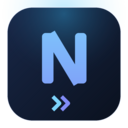
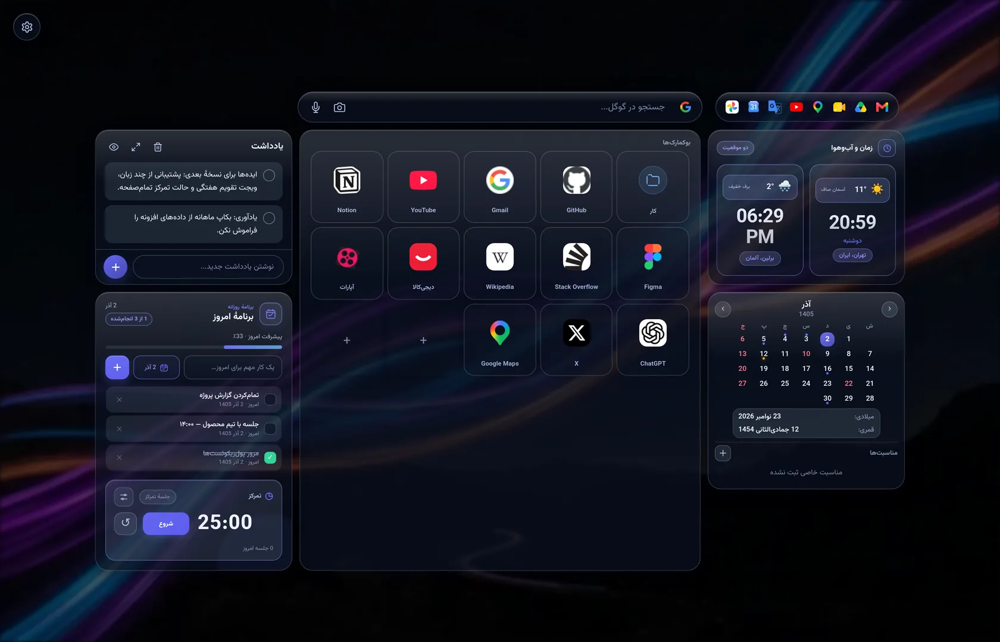
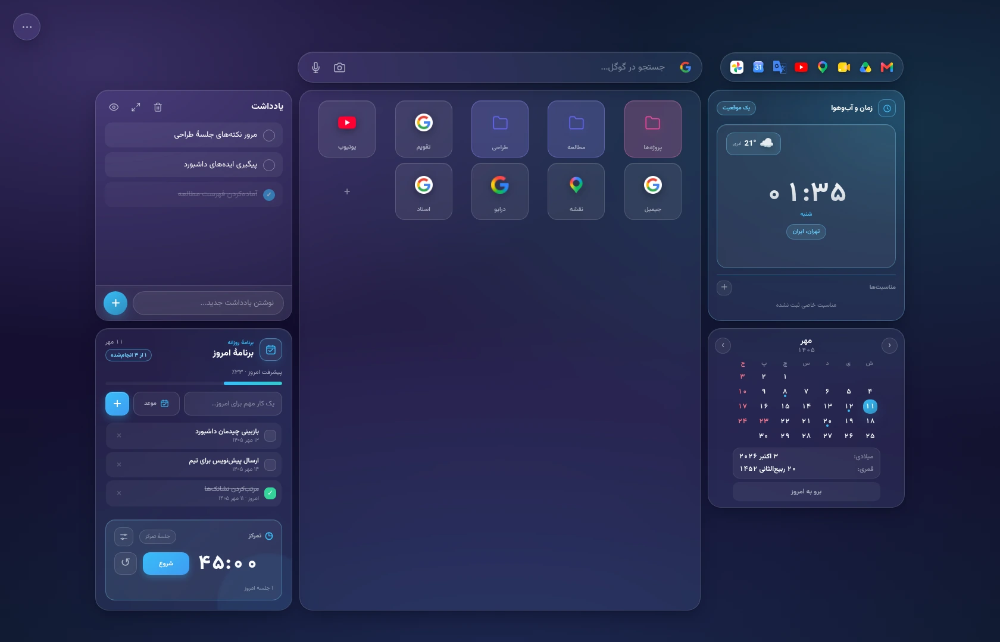
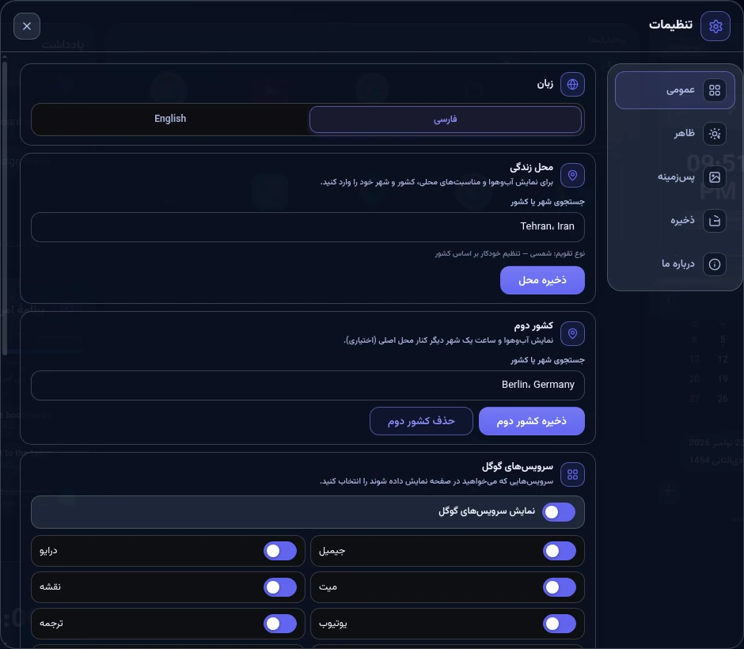
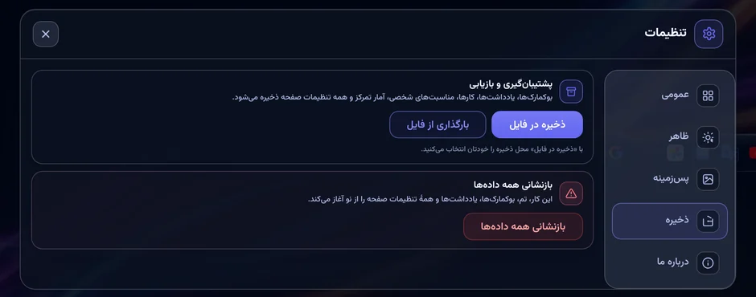

# NextTab




**صفحه New Tab شخصی شما — تقویم، بوکمارک، آب‌وهوا، یادداشت، سرویس‌های گوگل و تم، همه در یک صفحه زیبا.**

[](https://github.com/farzadqavidel/Chrome-Extention)
[](https://developer.chrome.com/docs/extensions/)

[English README](./README.md)

---

<p align="center">
  
</p>

<p align="center"><em>داشبورد نمونه با تهران و برلین؛ محتوای همگام‌شدهٔ نوار بوکمارک مستقیماً در NextTab باز است.</em></p>

<p align="center">
  
</p>

<p align="center"><em>همان داشبورد نمونه در چیدمان متوازنِ یک‌موقعیتی.</em></p>


## معرفی

**NextTab** جایگزین صفحه New Tab پیش‌فرض کروم است — یک داشبورد شخصی برای استفاده روزانه.

این افزونه **تقویم منطقه‌ای** (شمسی، قمری یا میلادی)، **بوکمارک‌ها**، **جستجوی گوگل**، **آب‌وهوا**، **یادداشت‌ها**، **دسترسی سریع به سرویس‌های گوگل** و **تنظیمات ظاهری** را در یک صفحه جمع می‌کند. داده‌ها محلی می‌مانند؛ در صورت فعال‌کردن «پیروی از بوکمارک کروم»، بوکمارک‌ها با فضای بوکمارک خود Chrome همگام می‌شوند.


## با چه زبان‌هایی نوشته شده؟

| بخش | فناوری |
|-----|--------|
| هسته افزونه | **HTML5**، **CSS3**، **JavaScript** (Manifest V3) |
| ذخیره‌سازی | `chrome.storage.local` + IndexedDB (والپیپرها) |
| تقویم | الگوریتم اختصاصی جلالی، قمری و میلادی |
| آب‌وهوا | [Open-Meteo API](https://open-meteo.com/) |
| فونت | [Vazirmatn](https://fonts.google.com/) از Google Fonts |


## امکانات

### تقویم منطقه‌ای
- تقویم **شمسی** (ایران و افغانستان)، **قمری** (کشورهای عربی و مسلمان) یا **میلادی** (سایر کشورها)
- نوع تقویم **به‌صورت خودکار** بر اساس کشور شما تنظیم می‌شود
- ساعت زنده برای موقعیت اصلی و **شهر دوم** (اختیاری)
- تاریخ‌های منطقه‌ای در تقویم نمایش داده می‌شوند؛ تاریخ از کارت اطلاعات موقعیت حذف شده است
- نمایش همزمان تاریخ میلادی، شمسی و قمری
- مناسبت‌ها و تعطیلات ایران، قمری و بین‌المللی
- ثبت تولد و سالگردهای شخصی با تقویم شمسی، قمری یا میلادی و شمارش‌معکوس
- جمعه‌ها / یکشنبه‌ها بر اساس منطقه برجسته می‌شوند

### بوکمارک‌ها
- بوکمارک نامحدود در گروه‌های پوشه‌ای با رنگ دلخواه
- گروه پیش‌فرض و گروه‌های سفارشی؛ پیمایش با دکمه بازگشت
- آیکون خودکار سایت‌ها (favicon) با fallback حرف اول
- کلیک راست برای ویرایش، حذف یا باز کردن در تب جدید
- کشیدن بوکمارک برای تغییر ترتیب، انداختن بوکمارک صفحهٔ اصلی داخل پوشه، یا بیرون‌کشیدن آن به صفحهٔ اصلی
- **دکمهٔ نیم‌دایره‌ای بوکمارک در سایت‌ها** — با کشیدن، جای عمودی یا سمت چپ/راستش را عوض کن؛ با هاور وضعیت ذخیره و نام پوشه را ببین؛ کلیک برای افزودن یا حذف
- جلوگیری از ثبت لینک تکراری و امکان خاموش‌کردن دکمهٔ شناور از تنظیمات
- **ایمپورت از کروم** — انتقال بوکمارک‌ها با حفظ پوشه‌های تودرتو
- **پیروی از بوکمارک کروم** — همگام‌سازی پیوسته و دوطرفهٔ افزودن، حذف، جابه‌جایی، ترتیب و پوشه‌های تودرتو؛ فعال‌سازی پیش از جایگزینی درخت بوکمارک هشدار می‌دهد. در این حالت NextTab مستقیم داخل «نوار بوکمارک» باز می‌شود؛ پوشه‌های ریشهٔ دیگر در Chrome حفظ‌اند اما در صفحهٔ NextTab نمایش داده نمی‌شوند.

### جستجو
- نوار جستجوی گوگل (متن، جستجوی صوتی*، جستجوی تصویر)
- **سابقه جستجو** — ذخیره محلی، قابل فیلتر و حذف
- نتیجه در همان تب باز می‌شود

### آب‌وهوا
- وضعیت فعلی بر اساس GPS یا جستجوی شهر
- متن ویجت آب‌وهوا فقط وضعیت فعلی را نشان می‌دهد؛ نماد و دما باقی‌اند. نام شهر در برچسب موقعیت کنار ساعت می‌آید و تاریخ در تقویم نمایش داده می‌شود، نه زیر ساعت یا داخل ویجت هوا
- **کشور دوم** (اختیاری) — دو ویجت آب‌وهوا کنار هم
- پیش‌بینی چند روزه با تاریخ محلی درست

### سرویس‌های گوگل
- دسترسی سریع به **جیمیل، درایو، نقشه، یوتیوب، ترجمه، تقویم و عکس**
- به‌صورت **قرص آیکون‌های کوچک کنار نوار جستجو** — بدون اشغال فضای اضافه صفحه
- نمایش/مخفی کردن و انتخاب سرویس‌های دلخواه
- قابل تنظیم در تنظیمات → عمومی

### برنامهٔ روزانه و تمرکز
- چک‌لیست کارها با موعد، وضعیت انجام و نوار پیشرفت روزانه
- انتخاب موعد با تقویم شمسی؛ تاریخ به‌صورت استاندارد میلادی ذخیره می‌شود تا مرتب‌سازی و سازگاری داده‌ها حفظ شود
- مدت تمرکز را برحسب روز، ساعت و دقیقه تنظیم کن؛ وضعیت و آمار جلسه‌ها ذخیره می‌شود. مقدار مدت استراحت ذخیره می‌ماند و در این فرم ویرایش نمی‌شود (پیش‌فرض ۲۵/۵ دقیقه)
- شمارش‌گرهای طولانی با زمان باقی‌مانده و زمان پایان دقیق ذخیره و بازیابی می‌شوند
- ثبت کار یا یادداشت سریع از صفحهٔ میان‌برها

### سایت‌های محبوب ایران و اخبار
- بخش «سایت‌های محبوب ایران» با تب‌بندی دسته‌ها: فیلم و سرگرمی (آپارات، فیلیمو، نماوا)، تاکسی و حمل‌ونقل (اسنپ، تپ‌تیس، کارپینو)، فروشگاه و خرید (دیجی‌کالا، باسلام) و معروف‌ها (گوگل، یوتیوب، ویکی‌پدیا، دیوار، ترب، نقشه)
- افزودن و حذف سایت دلخواه + بازنشانی پیش‌فرض‌ها؛ لیست در تنظیمات ذخیره می‌شود
- بخش اخبار (زومیت، دیجیاتو، ورزش۳، تجارت‌نیوز، بی‌بی‌سی فارسی، دیجی‌کالا مگ) و کارت زندهٔ ارز و قیمت‌ها (tgju.org) پایین داشبورد نمایش داده می‌شوند — هرکدام قابل نمایش/مخفی‌سازی در بخش عمومی تنظیمات هستند

### میان‌برها و حریم خصوصی
- پنل فرمان با `Ctrl+K` برای جستجوی بوکمارک‌ها و سرویس‌ها و اجرای کارهای سریع
- حالت حریم خصوصی با `Ctrl+Shift+H` برای محو کردن بوکمارک‌ها، یادداشت‌ها، کارها و مناسبت‌ها
- میان‌بر شروع/مکث تایمر تمرکز: `Ctrl+Shift+F`

### یادداشت‌ها
- پنل یادداشت سریع با سطل زباله و بازیابی
- نمای بزرگ‌تر برای لیست طولانی
- امکان مخفی‌سازی (blur) برای حریم خصوصی

### ظاهر و تنظیمات
- **تم‌های رنگی:** نیمه‌شب، اقیانوس، جنگل، اسطوخودوس، شیشه‌ای *(پیش‌فرض)*
- **پس‌زمینه:** گرادیانت، رنگ ساده، URL، آپلود، یا والپیپرهای 4K
- کنترل بلور و تیرگی روی تصویر
- **حالت عملکرد:** خودکار / سبک / کامل — غیرفعال‌سازی افکت‌های سنگین برای سیستم‌های ضعیف‌تر
- **زبان رابط:** فارسی و English
- جابه‌جایی ویجت‌ها با کشیدن از فهرست تنظیمات یا روی خود داشبورد؛ فقط جایگاه‌های امن شبکهٔ واکنش‌گرا در دسترس‌اند و اندازهٔ شبکه به‌هم نمی‌ریزد
- مخفی‌کردن ویجت‌ها و جابه‌جایی دقیق با دکمه‌های بالا/پایین
- انتخاب نمایش ارقام فارسی یا لاتین
- خروجی و ورود JSON (پشتیبان‌گیری)
- بازنشانی به حالت اولیه

<p align="center">
  
</p>

<p align="center"><em>تنظیمات ← عمومی — زبان، موقعیت اصلی و دوم و سرویس‌های گوگل.</em></p>

### راه‌اندازی اولیه
- **ویزارد تنظیمات اولیه** — انتخاب کشور، شهر و زبان در اولین اجرا
- **پیام خوش‌آمدگویی** — نکات مهم درباره محل نصب افزونه و پشتیبان‌گیری

<p align="center">
  
</p>

<p align="center"><em>ذخیره و بازیابی — همگام‌سازی پیوستهٔ بوکمارک کروم فعال است.</em></p>


## نصب

### ۱ · دریافت پروژه

**روش اول — Clone با Git**

```bash
git clone https://github.com/farzadqavidel/tabyar-chrome-extension.git
cd tabyar-chrome-extension
```

**روش دوم — دانلود ZIP**

1. به [Chrome-Extention](https://github.com/farzadqavidel/tabyar-chrome-extension.git) بروید
2. **Code → Download ZIP** را بزنید
3. فایل را Extract کنید

> **نکته مهم:** قبل از نصب، پوشه را در **محل ثابت و مناسب** قرار دهید — مثلاً:
>
> ```
> C:\Extensions\Chrome-Extention
> ```
>
> اگر بعداً پوشه را جابه‌جا یا حذف کنید، کروم افزونه را غیرفعال می‌کند و باید دوباره Load unpacked انجام دهید.

---

### ۲ · بارگذاری در کروم

1. کروم را باز کنید و به این آدرس بروید:

   ```
   chrome://extensions/
   ```

2. **Developer mode** (حالت توسعه‌دهنده) را در بالای صفحه **روشن** کنید

3. روی **Load unpacked** (بارگذاری بدون بسته‌بندی) کلیک کنید

4. پوشه افزونه را انتخاب کنید (همان پوشه‌ای که `manifest.json` داخلش است)

5. یک **New Tab** باز کنید — ویزارد راه‌اندازی را تکمیل کنید و از NextTab لذت ببرید!

---

## راهنمای استفاده

| کار | روش |
|-----|-----|
| باز کردن تنظیمات | آیکون **چرخ‌دنده** (بالا سمت راست) |
| تنظیم محل زندگی | تنظیمات → **عمومی** → جستجوی شهر یا کشور |
| افزودن کشور دوم | تنظیمات → **عمومی** → کشور دوم |
| تغییر تم رنگی | تنظیمات → **ظاهر** → انتخاب تم |
| تنظیم پس‌زمینه | تنظیمات → **پس‌زمینه** → گرادیانت، رنگ یا تصویر |
| حالت عملکرد | تنظیمات → **ظاهر** → خودکار / سبک / کامل |
| سرویس‌های گوگل | تنظیمات → **عمومی** → سرویس‌های گوگل |
| ذخیرهٔ صفحهٔ فعلی از هر سایت | دکمهٔ شناور **+** کنار صفحهٔ وب |
| افزودن بوکمارک | ورود به یک گروه → کلیک روی کاشی **+** |
| پنل فرمان | `Ctrl+K` |
| حالت حریم خصوصی | `Ctrl+Shift+H` |
| شروع / مکث تمرکز | `Ctrl+Shift+F` |
| افزودن تولد یا مناسبت شخصی | دکمهٔ **+** کنار عنوان مناسبت‌ها |
| چیدمان و نمایش ویجت‌ها | تنظیمات → **ظاهر** → چیدمان داشبورد |
| ایمپورت از کروم | تنظیمات → **ذخیره** → ایمپورت از کروم |
| پیش‌بینی آب‌وهوا | کلیک روی **ویجت آب‌وهوا** (کارت بالا سمت چپ) |
| سابقه جستجو | فوکوس روی نوار جستجو یا کلیک راست → نمایش سابقه |
| تغییر زبان | تنظیمات → **عمومی** → فارسی / English |
| پشتیبان‌گیری | تنظیمات → **ذخیره** → Export به فایل JSON |
| بازیابی | تنظیمات → **ذخیره** → Import از فایل JSON |

همه تنظیمات به‌صورت خودکار ذخیره می‌شوند و بعد از بستن مرورگر هم باقی می‌مانند.

---

## ساختار پروژه

```
Chrome-Extention/
├── manifest.json
├── newtab.html
├── css/
│   ├── styles.css
│   └── critical.css
├── js/
│   ├── app.js
│   ├── float-bookmark.js
│   ├── command-palette.js
│   ├── dashboard-layout.js
│   ├── tasks.js
│   ├── personal-events.js
│   ├── privacy.js
│   ├── storage.js
│   ├── settings.js
│   ├── wallpaper.js
│   ├── background.js
│   ├── calendar.js
│   ├── bookmarks.js
│   ├── notes.js
│   ├── weather.js
│   ├── search.js
│   ├── google-services.js
│   ├── location-picker.js
│   ├── region.js
│   ├── locale.js
│   ├── i18n.js
│   ├── jalali.js
│   ├── hijri.js
│   └── events.js
├── icons/
├── Picture/
├── README.md
└── README-fa.md
```


## دسترسی‌ها (Permissions)

| دسترسی | دلیل |
|--------|------|
| `storage` | ذخیره بوکمارک، یادداشت و تنظیمات |
| `bookmarks` | ایمپورت یک‌باره یا همگام‌سازی انتخابی و دوطرفهٔ بوکمارک‌های کروم با پوشه‌های تودرتو |
| `tabs` | باز کردن لینک‌ها در تب جدید |
| دسترسی سایت (`http`/`https` و در صورت نیاز `file://`) | نمایش دکمهٔ شناور ذخیرهٔ صفحهٔ فعلی در NextTab |
| `4kwallpapers.com` | بارگذاری والپیپرهای آماده |
| `api.open-meteo.com` | داده آب‌وهوا |
| `geocoding-api.open-meteo.com` | نام شهر از مختصات / منطقه زمانی |

بوکمارک‌ها، کارها، مناسبت‌های شخصی، یادداشت‌ها و تنظیمات به‌صورت محلی ذخیره می‌شوند. اگر «پیروی از بوکمارک کروم» را فعال کنید، بوکمارک‌ها در فضای بوکمارک خود کروم با NextTab همگام می‌شوند؛ هیچ‌کدام به سرور بیرونی ارسال نمی‌شود. دکمهٔ شناور فقط پس از کلیک، عنوان و نشانی همان صفحه را ذخیره می‌کند و محتوای صفحه را نمی‌خواند. برای نمایش آن در همهٔ سایت‌های معمولی، کروم دسترسی صفحه‌های وب (`http`/`https`) را درخواست می‌کند. به‌دلیل محدودیت کروم، این دکمه روی صفحه‌های داخلی مثل `chrome://` و فروشگاه وب کروم نمایش داده نمی‌شود. برای فایل‌های محلی `file://` باید گزینهٔ **Allow access to file URLs** را در جزئیات افزونه روشن کنید. درخواست‌های شبکه فقط برای آب‌وهوا، ژئوکدینگ و والپیپری است که خودتان انتخاب می‌کنید.


## میان‌برها

| کار | میان‌بر |
|-----|---------|
| بازکردن پنل فرمان | `Ctrl+K` |
| حالت حریم خصوصی | `Ctrl+Shift+H` |
| شروع / مکث تمرکز | `Ctrl+Shift+F` |

## توسعه

1. فایل‌ها را ویرایش کنید
2. به `chrome://extensions/` بروید
3. روی **Reload** افزونه NextTab کلیک کنید
4. یک New Tab باز کنید


## نکات

- بار اول ممکن است برای **فونت** و **آب‌وهوا** به اینترنت نیاز باشد
- جستجوی صوتی به پشتیبانی مرورگر از Web Speech API بستگی دارد
- نوع تقویم از روی کشور شما تشخیص داده می‌شود؛ با تغییر محل زندگی در تنظیمات قابل تغییر است
- برای تجربه پیش‌فرض تمیز، از **بازنشانی همه داده‌ها** در تنظیمات استفاده کنید

