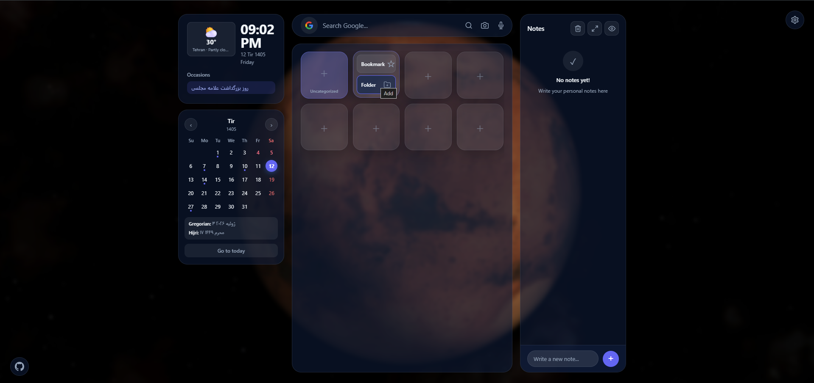

# Tabyar — تب‌یار

**صفحه New Tab شخصی شما — تقویم، بوکمارک، آب‌وهوا، یادداشت و تم، همه در یک صفحه زیبا.**

[](https://github.com/farzadqavidel/Chrome-Extention)
[](https://developer.chrome.com/docs/extensions/)

[English README](./README.md)

---

<p align="center">
  
</p>

<p align="center"><em>نمای کلی داشبورد Tabyar</em></p>

---

## معرفی

**Tabyar (تب‌یار)** جایگزین صفحه New Tab پیش‌فرض کروم است — یک داشبورد شخصی برای استفاده روزانه.

این افزونه **تقویم شمسی**، **بوکمارک‌ها**، **جستجوی گوگل**، **آب‌وهوا**، **یادداشت‌ها** و **تنظیمات ظاهری** را در یک صفحه جمع کرده و همه داده‌ها را **به‌صورت محلی** در مرورگر شما ذخیره می‌کند.

> **نسخه فعلی:** `1.1.0`

---

## با چه زبان‌هایی نوشته شده؟

| بخش | فناوری |
|-----|--------|
| هسته افزونه | **HTML5**، **CSS3**، **JavaScript** (Manifest V3) |
| ذخیره‌سازی | `chrome.storage.local` + IndexedDB (والپیپرها) |
| تقویم | الگوریتم اختصاصی جلالی و قمری |
| آب‌وهوا | [Open-Meteo API](https://open-meteo.com/) |
| ترجمه | [MyMemory API](https://mymemory.translated.net/) |
| فونت | [Vazirmatn](https://fonts.google.com/) از Google Fonts |

---

## امکانات

### تقویم شمسی
- تقویم **جلالی** دقیق با پیمایش ماه‌به‌ماه
- ساعت و تاریخ زنده — مطابق **منطقه زمانی و تنظیمات سیستم** شما
- نمایش تاریخ میلادی و قمری
- مناسبت‌ها و تعطیلات رسمی ایران
- جمعه‌ها با رنگ متمایز

### بوکمارک‌ها
- بوکمارک نامحدود با گروه‌بندی و رنگ دلخواه
- آیکون خودکار سایت‌ها (favicon) با fallback حرف اول
- Import از بوکمارک‌های کروم (همراه ساختار پوشه)
- کلیک راست برای ویرایش یا حذف

### جستجو
- نوار جستجوی گوگل (متن، جستجوی صوتی*، جستجوی تصویر)
- نتیجه در همان تب باز می‌شود

### آب‌وهوا
- وضعیت فعلی بر اساس موقعیت GPS یا منطقه زمانی سیستم
- پیش‌بینی چند روزه با تاریخ محلی درست

### مترجم
- ترجمه سریع **انگلیسی ↔ فارسی** در پنجره کوچک
- تعویض جهت با یک کلیک؛ کپی نتیجه

### یادداشت‌ها
- پنل یادداشت سریع با سطل زباله و بازیابی
- نمای بزرگ‌تر برای لیست طولانی
- امکان مخفی‌سازی (blur) برای حریم خصوصی

### ظاهر و تنظیمات
- **تم‌های رنگی:** نیمه‌شب، اقیانوس، جنگل، اسطوخودوس، شیشه‌ای *(پیش‌فرض)*
- **پس‌زمینه:** گرادیانت، رنگ ساده، URL، آپلود، یا والپیپرهای 4K
- کنترل بلور و تیرگی روی تصویر
- **زبان رابط:** فارسی و English
- خروجی و ورود JSON (پشتیبان‌گیری)
- بازنشانی به حالت اولیه

<p align="center">
  
</p>

<p align="center"><em>پنجره تنظیمات — تم، پس‌زمینه و پشتیبان‌گیری</em></p>

---

## نصب

### ۱ · دریافت پروژه

**روش اول — Clone با Git**

```bash
git clone https://github.com/farzadqavidel/Chrome-Extention.git
cd Chrome-Extention
```

**روش دوم — دانلود ZIP**

1. به [github.com/farzadqavidel/Chrome-Extention](https://github.com/farzadqavidel/Chrome-Extention) بروید
2. **Code → Download ZIP** را بزنید
3. فایل را Extract کنید

> **نکته مهم:** قبل از نصب، پوشه را در **محل ثابت و مناسب** قرار دهید — مثلاً:
>
> ```
> C:\Extensions\Chrome-Extention
> ```
>
> اگر بعداً پوشه را جابه‌جا یا حذف کنید، کروم افزونه را غیرفعال می‌کند و باید دوباره Load unpacked انجام دهید.

---

### ۲ · بارگذاری در کروم

1. کروم را باز کنید و به این آدرس بروید:

   ```
   chrome://extensions/
   ```

2. **Developer mode** (حالت توسعه‌دهنده) را در بالای صفحه **روشن** کنید

3. روی **Load unpacked** (بارگذاری بدون بسته‌بندی) کلیک کنید

4. پوشه افزونه را انتخاب کنید (همان پوشه‌ای که `manifest.json` داخلش است)

5. یک **New Tab** باز کنید — Tabyar آماده است

**لذت ببرید!**

---

## راهنمای استفاده

| کار | روش |
|-----|-----|
| باز کردن تنظیمات | آیکون **چرخ‌دنده** (بالا سمت راست) |
| تغییر تم رنگی | تنظیمات → **ظاهر** → انتخاب تم |
| تنظیم پس‌زمینه | تنظیمات → **پس‌زمینه** → گرادیانت، رنگ یا تصویر |
| افزودن بوکمارک | دکمه **+** در ستون وسط |
| Import بوکمارک کروم | دکمه import در بخش بوکمارک‌ها |
| تغییر زبان | تنظیمات → **زبان** → فارسی / English |
| باز کردن مترجم | آیکون **ترجمه** (بالا سمت راست) |
| پشتیبان‌گیری | تنظیمات → **ذخیره** → Export به فایل JSON |
| بازیابی | تنظیمات → **ذخیره** → Import از فایل JSON |

همه تنظیمات به‌صورت خودکار ذخیره می‌شوند و بعد از بستن مرورگر هم باقی می‌مانند.

---

## ساختار پروژه

```
Chrome-Extention/
├── manifest.json
├── newtab.html
├── css/styles.css
├── js/
│   ├── app.js
│   ├── storage.js
│   ├── settings.js
│   ├── wallpaper.js
│   ├── background.js
│   ├── calendar.js
│   ├── bookmarks.js
│   ├── notes.js
│   ├── weather.js
│   ├── locale.js
│   ├── translator.js
│   ├── i18n.js
│   ├── jalali.js
│   ├── hijri.js
│   └── events.js
├── icons/
├── Picture/
├── README.md
└── README-fa.md
```

---

## دسترسی‌ها (Permissions)

| دسترسی | دلیل |
|--------|------|
| `storage` | ذخیره بوکمارک، یادداشت و تنظیمات |
| `bookmarks` | Import اختیاری از بوکمارک کروم |
| `4kwallpapers.com` | بارگذاری والپیپرهای آماده |
| `api.open-meteo.com` | داده آب‌وهوا |
| `geocoding-api.open-meteo.com` | نام شهر از مختصات / منطقه زمانی |
| `api.mymemory.translated.net` | ترجمه (فقط هنگام استفاده از مترجم) |

داده‌های شخصی شما به سرور شخص ثالث ارسال نمی‌شود — فقط درخواست آب‌وهوا، ژئوکدینگ، ترجمه و دانلود والپیپری که خودتان انتخاب می‌کنید.

---

## توسعه

1. فایل‌ها را ویرایش کنید
2. به `chrome://extensions/` بروید
3. روی **Reload** افزونه Tabyar کلیک کنید
4. یک New Tab باز کنید

---

## نکات

- بار اول ممکن است برای **فونت** و **آب‌وهوا** به اینترنت نیاز باشد
- جستجوی صوتی به پشتیبانی مرورگر از Web Speech API بستگی دارد
- برای تجربه پیش‌فرض تمیز، از **بازنشانی همه داده‌ها** در تنظیمات استفاده کنید

---

## توسعه‌دهنده

[farzadqavidel](https://github.com/farzadqavidel)

اگر Tabyar برایتان مفید بود، ستاره (Star) دادن به مخزن GitHub خیلی کمک می‌کند.

---

<p align="center">
  <strong>Tabyar</strong> · نسخه 1.1.0 · ساخته شده با دقت برای یک New Tab بهتر
</p>
