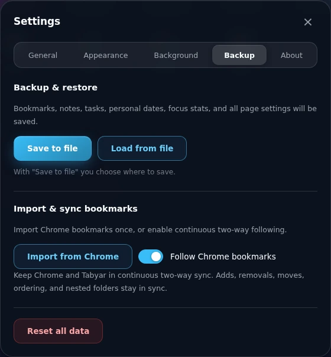

# Tabyar

**Your personal New Tab — calendar, bookmarks, weather, notes, Google services, and themes in one beautiful page.**

[](https://github.com/farzadqavidel/Chrome-Extention)
[](https://developer.chrome.com/docs/extensions/)
[](#)

[مستندات فارسی](./README-fa.md)

---

<p align="center">
  
</p>

<p align="center"><em>Tabyar — custom New Tab dashboard</em></p>


## Overview

**Tabyar** replaces Chrome’s default New Tab with a customizable dashboard designed for daily use.  
It combines a **regional calendar** (Jalali, Hijri, or Gregorian), **bookmarks**, **Google search**, **weather**, **notes**, **Google services shortcuts**, and rich **appearance settings** — all stored locally in your browser.

> **Version:** `1.5.0` — Redesigned bento-grid layout: polished glass cards, a compact Google-services pill beside the search bar, tighter spacing that fits the whole dashboard in view without scrolling, plus full responsiveness from small laptops to 4K displays.


## Built With

| Layer | Technology |
|-------|------------|
| Extension core | **HTML5**, **CSS3**, **JavaScript** (Manifest V3) |
| Storage | Chrome `storage.local` + IndexedDB (wallpapers) |
| Calendar | Custom Jalali, Hijri & Gregorian algorithms |
| Weather | [Open-Meteo API](https://open-meteo.com/) |
| Fonts | [Vazirmatn](https://fonts.google.com/) via Google Fonts |

---

## Features

### Calendar
- **Regional calendar** — Jalali (Iran/Afghanistan), Hijri (Arab & Muslim countries), or Gregorian (worldwide)
- Calendar type is **set automatically** based on your country
- Live clock and today’s date — follows your **system timezone and locale**
- Secondary clock for an optional **second location**
- Gregorian, Jalali & Hijri date display side by side
- Iranian, Hijri & international occasions & holidays
- Fridays / Sundays highlighted based on region

### Bookmarks
- Unlimited bookmarks in folder groups with custom colors
- Default group plus custom groups; navigate with back button
- Auto favicon loading with letter fallback
- Right-click to edit, delete, or open in a new tab
- **Import from Chrome** — transfer all Chrome bookmarks with folder structure

### Search
- Google search bar (text, voice*, image search)
- **Search history** — recent queries saved locally, filterable and removable
- Opens results in the same tab

### Weather
- Current weather for your location (GPS or city search)
- Optional **second location** — dual weather widgets side by side
- Multi-day forecast modal with correct local dates
- Powered by Open-Meteo

### Google Services
- Quick-access tiles for **Gmail, Drive, Maps, YouTube, Translate, Calendar & Photos**
- Rendered as a **compact icon pill next to the search bar** — no wasted space
- Show/hide the pill and pick which services appear
- Configurable in Settings → General

### Notes
- Quick notes panel with trash & restore
- Expand view for longer lists
- Optional blur for privacy

### Appearance & Settings
- **Color themes:** Midnight, Ocean, Forest, Lavender, Glass *(default)*
- **Backgrounds:** gradients, solid colors, image URL, upload, or curated 4K wallpapers
- Blur & overlay controls for background images
- **Performance mode:** Auto / Lite / Full — disables heavy effects on weaker systems
- **Languages:** Persian (FA) & English (EN)
- Export / import all data as JSON
- Reset to defaults

<p align="center">
  
</p>

<p align="center"><em>Settings — location, themes & Google services</em></p>

### First-time Setup
- **Onboarding wizard** — choose your country, city, and language on first launch
- **Welcome message** — tips about keeping the extension folder in a stable location and backing up data

<p align="center">
  
</p>

<p align="center"><em>Backup — export, import & Chrome bookmarks transfer</em></p>


## Installation

### 1 · Get the project

**Option A — Clone with Git**

```bash
git clone https://github.com/farzadqavidel/tabyar-chrome-extension.git
cd Chrome-Extention
```

**Option B — Download ZIP**

1. Open [Chrome-Extention](https://github.com/farzadqavidel/tabyar-chrome-extension.git)
2. Click **Code → Download ZIP**
3. Extract the archive to a permanent folder

> **Important:** Choose a stable location **before** loading the extension — for example:
>
> ```
> C:\Extensions\Chrome-Extention
> ```
>
> If you move or delete the folder later, Chrome will disable the extension and you will need to load it again.

---

### 2 · Load in Chrome

1. Open Chrome and go to:

   ```
   chrome://extensions/
   ```

2. Enable **Developer mode** (toggle in the top-right corner)

3. Click **Load unpacked**

4. Select the extension folder (the one containing `manifest.json`)

5. Open a **new tab** — complete the onboarding wizard and enjoy Tabyar!

---

## Usage Guide

| Action | How |
|--------|-----|
| Open settings | Click the **gear icon** (top-right) |
| Set location | Settings → **General** → search city or country |
| Add second location | Settings → **General** → Second location |
| Change theme | Settings → **Appearance** → pick a color theme |
| Set background | Settings → **Background** → gradient, color, or image |
| Performance mode | Settings → **Appearance** → Auto / Lite / Full |
| Toggle Google services | Settings → **General** → Google services |
| Add bookmark | Open a folder group → click the **+** tile |
| Import Chrome bookmarks | Settings → **Backup** → Import from Chrome |
| Weather forecast | Click the **weather widget** (top-left card) |
| Search history | Focus the search bar or right-click → Show history |
| Switch language | Settings → **General** → فارسی / English |
| Backup data | Settings → **Backup** → Export to JSON file |
| Restore data | Settings → **Backup** → Import from JSON file |

All preferences are saved automatically and persist across browser restarts.


## Project Structure

```
Chrome-Extention/
├── manifest.json          # Extension manifest (MV3)
├── newtab.html            # New Tab page
├── css/
│   ├── styles.css         # All styles
│   └── critical.css       # Critical above-the-fold CSS
├── js/
│   ├── app.js             # Bootstrap & onboarding
│   ├── storage.js         # Data layer
│   ├── settings.js        # Themes & backgrounds
│   ├── wallpaper.js       # Wallpaper fetch & cache
│   ├── background.js      # Service worker
│   ├── calendar.js        # Regional calendar UI
│   ├── bookmarks.js       # Bookmarks manager
│   ├── notes.js           # Notes panel
│   ├── weather.js         # Weather widget (dual location)
│   ├── search.js          # Google search & history
│   ├── google-services.js # Google services shortcuts
│   ├── location-picker.js # City/country search
│   ├── region.js          # Country → calendar mapping
│   ├── locale.js          # System timezone & locale helpers
│   ├── i18n.js            # FA / EN UI strings
│   ├── jalali.js          # Jalali date math
│   ├── hijri.js           # Hijri date math
│   └── events.js          # Occasions & holidays data
├── icons/                 # Extension icons
├── Picture/               # Screenshots for README
├── README.md
└── README-fa.md           # Persian documentation
```


## Permissions

| Permission | Why |
|------------|-----|
| `storage` | Save bookmarks, notes, and settings locally |
| `bookmarks` | Import Chrome bookmarks with folder structure |
| `tabs` | Open bookmark links in new tabs |
| `4kwallpapers.com` | Load curated background wallpapers |
| `api.open-meteo.com` | Weather data |
| `geocoding-api.open-meteo.com` | City name from coordinates / timezone |

No personal data is sent to third-party servers except weather, geocoding, and wallpaper downloads you choose.


## Development

1. Edit files in the project folder
2. Go to `chrome://extensions/`
3. Click the **reload** icon on the Tabyar card
4. Open a new tab to see changes


## Notes

- First load may require internet for **Google Fonts** and **weather**
- Voice search depends on browser support for Web Speech API
- Calendar type is auto-detected from your country; change location in settings to switch
- For a clean default experience, use **Reset all data** in settings


## Author

If you find Tabyar useful, consider starring the repository on GitHub.

