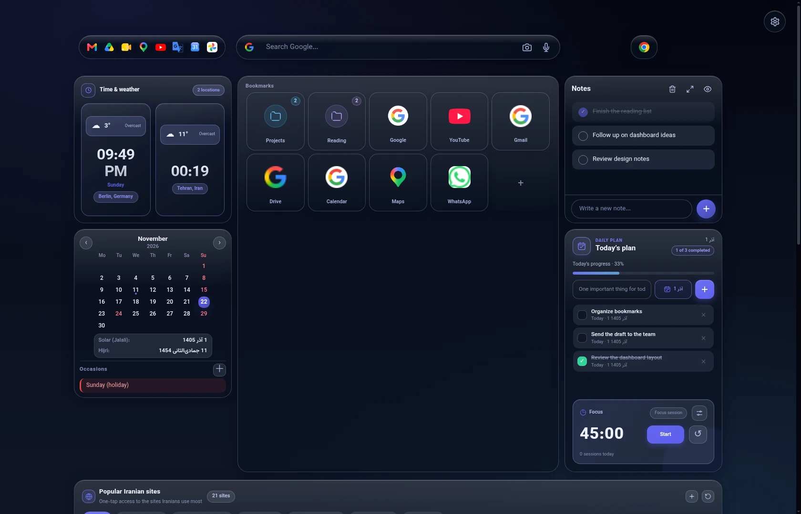
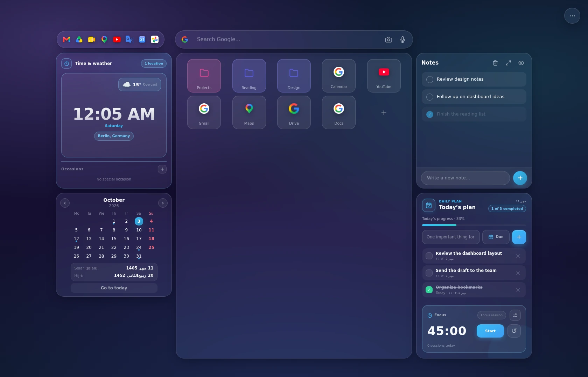
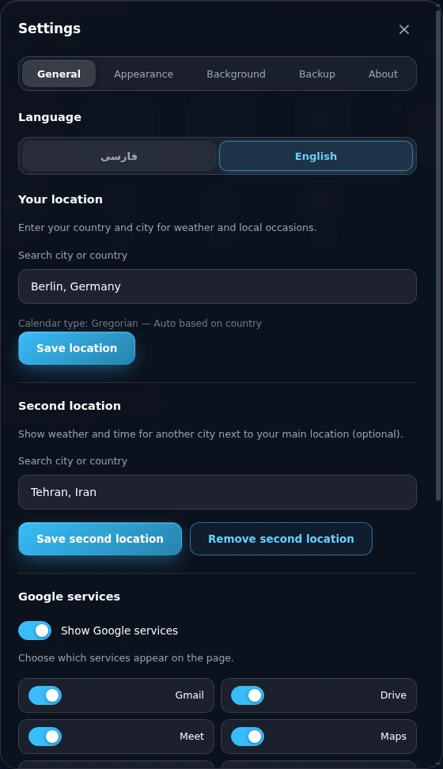

# Tabyar

**Your personal New Tab — calendar, bookmarks, weather, notes, Google services, and themes in one beautiful page.**

[](https://github.com/farzadqavidel/Chrome-Extention)
[](https://developer.chrome.com/docs/extensions/)
[](#)

[مستندات فارسی](./README-fa.md)

---

<p align="center">
  
</p>

<p align="center"><em>Demo dashboard (Tehran + Berlin) — synced Bookmarks bar contents open in Tabyar.</em></p>

<p align="center">
  
</p>

<p align="center"><em>The same demo dashboard in the balanced single-location layout.</em></p>


## Overview

**Tabyar** replaces Chrome’s default New Tab with a customizable dashboard designed for daily use.  
It combines a **regional calendar** (Jalali, Hijri, or Gregorian), **bookmarks**, **Google search**, **weather**, **notes**, **Google services shortcuts**, and rich **appearance settings**. Data stays local; if **Follow Chrome bookmarks** is enabled, bookmarks sync with Chrome’s own bookmark store.

> **Version:** `1.6.0` — Redesigned bento-grid layout: polished glass cards, a compact Google-services pill beside the search bar, tighter spacing that fits the whole dashboard in view without scrolling, plus full responsiveness from small laptops to 4K displays.


## Built With

| Layer | Technology |
|-------|------------|
| Extension core | **HTML5**, **CSS3**, **JavaScript** (Manifest V3) |
| Storage | Chrome `storage.local` + IndexedDB (wallpapers) |
| Calendar | Custom Jalali, Hijri & Gregorian algorithms |
| Weather | [Open-Meteo API](https://open-meteo.com/) |
| Fonts | [Vazirmatn](https://fonts.google.com/) via Google Fonts |

---

## Features

### Calendar
- **Regional calendar** — Jalali (Iran/Afghanistan), Hijri (Arab & Muslim countries), or Gregorian (worldwide)
- Calendar type is **set automatically** based on your country
- Live clock for the primary location and an optional **second location**
- Regional dates remain in the calendar and are no longer repeated on the location card
- Gregorian, Jalali & Hijri date display side by side
- Iranian, Hijri & international occasions & holidays
- Personal birthdays and anniversaries with Jalali, Hijri, or Gregorian dates and countdowns
- Fridays / Sundays highlighted based on region

### Bookmarks
- Unlimited bookmarks in folder groups with custom colors
- Default group plus custom groups; navigate with back button
- Auto favicon loading with letter fallback
- Right-click to edit, delete, or open in a new tab
- Drag bookmarks to reorder them, drop a root bookmark into a folder, or drag a bookmark back to Home from inside a folder
- **Import from Chrome** — transfer bookmarks while preserving nested folders
- **Follow Chrome bookmarks** — continuous two-way sync for additions, deletions, moves, ordering, and nested folders; enabling it warns before replacing Tabyar's bookmark tree. In this mode, Tabyar opens directly inside **Bookmarks bar**; other Chrome root folders are preserved in Chrome but hidden from Tabyar’s view
- **Half-circle floating bookmark button** on regular websites; drag it vertically or snap it to either edge, hover to see whether the page is saved and in which folder, and click to add/remove it; it can be disabled in Settings

### Search
- Google search bar (text, voice*, image search)
- **Search history** — recent queries saved locally, filterable and removable
- Opens results in the same tab

### Weather
- Current weather for your location (GPS or city search)
- The weather pill’s text shows the current condition; its icon and temperature remain visible. The city stays in the location label by the clock, while the date stays in the calendar—not under the clock or in the weather pill
- Optional **second location** — dual weather widgets side by side
- Multi-day forecast modal with correct local dates
- Powered by Open-Meteo

### Google Services
- Quick-access tiles for **Gmail, Drive, Maps, YouTube, Translate, Calendar & Photos**
- Rendered as a **compact icon pill next to the search bar** — no wasted space
- Show/hide the pill and pick which services appear
- Configurable in Settings → General

### Daily plan & focus
- Daily to-do list with due dates, completion states, and progress
- Choose due dates in the Jalali calendar; store them canonically as Gregorian ISO dates for sorting and compatibility
- Set focus duration in days, hours, and minutes, with saved timer state and session count; the break-duration value is retained but is not edited in this form (25/5 minutes by default)
- Long timers persist as full-precision remaining times and end timestamps
- Create a task or note directly from the command palette

### Command palette & privacy
- `Ctrl+K` opens a keyboard-first launcher for bookmarks, enabled services, tasks, notes, and quick actions
- `Ctrl+Shift+H` blurs bookmarks, notes, tasks, and personal dates
- `Ctrl+Shift+F` starts or pauses the focus timer

### Notes
- Quick notes panel with trash & restore
- Expand view for longer lists
- Optional blur for privacy

### Appearance & Settings
- **Color themes:** Midnight, Ocean, Forest, Lavender, Glass *(default)*
- **Backgrounds:** gradients, solid colors, image URL, upload, or curated 4K wallpapers
- Blur & overlay controls for background images
- **Performance mode:** Auto / Lite / Full — disables heavy effects on weaker systems
- **Languages:** Persian (FA) & English (EN)
- Drag widgets from the settings list or on the dashboard; moves stay inside the existing responsive bento slots, with arrows as an accessible fallback
- Choose automatic, Persian, or Latin digits
- Export / import all data as JSON
- Reset to defaults

<p align="center">
  
</p>

<p align="center"><em>Settings → General — language, primary/secondary locations, and Google services.</em></p>

### First-time Setup
- **Onboarding wizard** — choose your country, city, and language on first launch
- **Welcome message** — tips about keeping the extension folder in a stable location and backing up data

<p align="center">
  
</p>

<p align="center"><em>Backup & restore — continuous Chrome bookmark sync is enabled.</em></p>


## Installation

### 1 · Get the project

**Option A — Clone with Git**

```bash
git clone https://github.com/farzadqavidel/tabyar-chrome-extension.git
cd tabyar-chrome-extension
```

**Option B — Download ZIP**

1. Open [Chrome-Extention](https://github.com/farzadqavidel/tabyar-chrome-extension.git)
2. Click **Code → Download ZIP**
3. Extract the archive to a permanent folder

> **Important:** Choose a stable location **before** loading the extension — for example:
>
> ```
> C:\Extensions\Chrome-Extention
> ```
>
> If you move or delete the folder later, Chrome will disable the extension and you will need to load it again.

---

### 2 · Load in Chrome

1. Open Chrome and go to:

   ```
   chrome://extensions/
   ```

2. Enable **Developer mode** (toggle in the top-right corner)

3. Click **Load unpacked**

4. Select the extension folder (the one containing `manifest.json`)

5. Open a **new tab** — complete the onboarding wizard and enjoy Tabyar!

---

## Usage Guide

| Action | How |
|--------|-----|
| Open settings | Click the **gear icon** (top-right) |
| Set location | Settings → **General** → search city or country |
| Add second location | Settings → **General** → Second location |
| Change theme | Settings → **Appearance** → pick a color theme |
| Set background | Settings → **Background** → gradient, color, or image |
| Performance mode | Settings → **Appearance** → Auto / Lite / Full |
| Toggle Google services | Settings → **General** → Google services |
| Add bookmark | Open a folder group → click the **+** tile |
| Import Chrome bookmarks | Settings → **Backup** → Import from Chrome |
| Weather forecast | Click the **weather widget** (top-left card) |
| Search history | Focus the search bar or right-click → Show history |
| Switch language | Settings → **General** → فارسی / English |
| Backup data | Settings → **Backup** → Export to JSON file |
| Restore data | Settings → **Backup** → Import from JSON file |

All preferences are saved automatically and persist across browser restarts.


## Project Structure

```
Chrome-Extention/
├── manifest.json          # Extension manifest (MV3)
├── newtab.html            # New Tab page
├── css/
│   ├── styles.css         # All styles
│   └── critical.css       # Critical above-the-fold CSS
├── js/
│   ├── app.js             # Bootstrap & onboarding
│   ├── storage.js         # Data layer
│   ├── settings.js        # Themes & backgrounds
│   ├── wallpaper.js       # Wallpaper fetch & cache
│   ├── background.js      # Service worker
│   ├── calendar.js        # Regional calendar UI
│   ├── bookmarks.js       # Bookmarks manager
│   ├── notes.js           # Notes panel
│   ├── tasks.js           # Daily tasks & Pomodoro timer
│   ├── personal-events.js # Personal date reminders
│   ├── dashboard-layout.js# Widget layout controls
│   ├── command-palette.js # Keyboard-first launcher
│   ├── float-bookmark.js  # One-click save button on web pages
│   ├── privacy.js         # Privacy mode
│   ├── weather.js         # Weather widget (dual location)
│   ├── search.js          # Google search & history
│   ├── google-services.js # Google services shortcuts
│   ├── location-picker.js # City/country search
│   ├── region.js          # Country → calendar mapping
│   ├── locale.js          # System timezone & locale helpers
│   ├── i18n.js            # FA / EN UI strings
│   ├── jalali.js          # Jalali date math
│   ├── hijri.js           # Hijri date math
│   └── events.js          # Occasions & holidays data
├── icons/                 # Extension icons
├── Picture/               # Screenshots for README
├── README.md
└── README-fa.md           # Persian documentation
```


## Permissions

| Permission | Why |
|------------|-----|
| `storage` | Save bookmarks, notes, and settings locally |
| `bookmarks` | Import Chrome bookmarks or opt into continuous two-way sync with nested folders |
| `tabs` | Open bookmark links in new tabs |
| Website access (`http` / `https`, optional `file://`) | Inject the floating one-click save button on regular web pages and, when file access is enabled, local pages |
| `4kwallpapers.com` | Load curated background wallpapers |
| `api.open-meteo.com` | Weather data |
| `geocoding-api.open-meteo.com` | City name from coordinates / timezone |

Bookmarks, tasks, personal dates, notes, and settings are stored locally. If **Follow Chrome bookmarks** is enabled, bookmarks sync with Chrome’s own bookmark store; they are not sent to an external server. The floating button saves only the current page title and URL when clicked and does not read page contents. Showing the button across regular websites requires Chrome’s `http`/`https` site access. Chrome does not permit content scripts on protected pages such as `chrome://` or the Chrome Web Store. Local `file://` pages require enabling **Allow access to file URLs** on the extension details page. Network requests are limited to weather, geocoding, and wallpapers you choose.


## Keyboard shortcuts

| Action | Shortcut |
|--------|----------|
| Open command palette | `Ctrl+K` |
| Toggle privacy mode | `Ctrl+Shift+H` |
| Start / pause focus timer | `Ctrl+Shift+F` |

## Development

1. Edit files in the project folder
2. Go to `chrome://extensions/`
3. Click the **reload** icon on the Tabyar card
4. Open a new tab to see changes


## Notes

- First load may require internet for **Google Fonts** and **weather**
- Voice search depends on browser support for Web Speech API
- Calendar type is auto-detected from your country; change location in settings to switch
- For a clean default experience, use **Reset all data** in settings


## Author

If you find Tabyar useful, consider starring the repository on GitHub.

